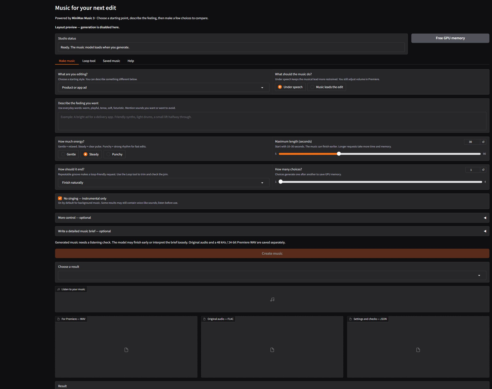

# ChocoJaYY Music Studio · MiniMax Music 3

A GPU-powered music studio for video edits. Start with ordinary words, make a few choices, and keep the track that fits your edit. Instrumental music is the default. The repository is public; credentials are entered only at runtime.

[](https://colab.research.google.com/github/ChocoJaYY/minimax-music-studio/blob/main/MiniMax_Music_Studio.ipynb)



## Start in Colab

1. Open the notebook above. No GitHub authorization or repository token is required. You can also download `MiniMax_Music_Studio.ipynb` and use **File → Upload notebook** in Colab.
2. Choose **Runtime → Change runtime type → GPU**.
3. Run **1. Prepare the GPU**. It downloads about **11.1 GiB** of pinned model weights and checks their SHA-256 hashes. A fresh runtime needs the download again. No paid music API or GitHub token is required: the notebook contains a checked copy of this app's small source bundle.
4. On **free Colab**, use **2. Make music**. Start with ten seconds, keep **No singing** on, and run the cell. Listen to the audio inside the notebook.
5. Run **3. Download** for the results you want. Save to **D:** on your PC. Colab's runtime files disappear when its session is deleted.

The GPU type, available RAM and session length depend on Colab. Setup requires a CUDA GPU and a preinstalled PyTorch version of at least 2.8. It reuses that CUDA stack instead of replacing Colab's drivers or PyTorch. Extra packages go into a separate environment. Actual compatibility/performance must be checked on the assigned runtime; see [VALIDATION.md](VALIDATION.md).

The first free **T4** run passed: a ten-second maximum request produced **9.996 seconds** in **115.17 seconds** from submission through export/QA, excluding backend startup and initial setup. It used the runtime's existing PyTorch 2.11.0/CUDA 13 stack and 12.67 GB system RAM. This is one observation; longer Colab tracks remain untested. Local CUDA generation, source checks and file/login checks also passed.

If Colab says its output JavaScript cannot load, refresh your Google session and follow its cookie/verification guidance. A blank audio area does not establish that generation failed; check the saved job before retrying. Google display/verification warnings affected our browser playback check, but a plain-text inspection of the saved job confirmed the T4 render and technical audio checks. See [VALIDATION.md](VALIDATION.md) for evidence and limits.

If an older web session shows `object of type 'NoneType' has no len()` when creating music, it is running the original empty-textbox bug. The current notebook fixes this. Stop the web launcher, reopen this notebook from GitHub, run step 1 in the same runtime to load the updated app, then restart step 4 and refresh the studio page. Existing verified model files are reused; saved music stays in `/content/minimax-output` until the runtime is deleted. Step 4 asks for the connection details again using hidden password/token input.

## Full web UI and your Cloudflare domain

The full interface has guided briefs, exact tempo/key controls, optional lyrics, 1–4 sequential choices, detailed arrangement fields, a loop tool and saved results. Help text uses examples and explains music terms.

**Use the external UI on paid Colab with a positive compute-unit balance, or on a GPU host you control.** Google's [Colab FAQ](https://research.google.com/colaboratory/faq.html) restricts primarily using an external web UI on free runtimes without compute units. The free workflow therefore runs generation directly from the notebook form. There is no anti-idle code or restriction bypass.

For the optional web launcher in notebook step 4:

1. Configure your Cloudflare route as **`your hostname → http://localhost:8188`** and keep Cloudflare Access sign-in enabled. The studio's private GPU backend listens on **127.0.0.1:8189**; never route the domain to it.
2. Rotate any tunnel token previously pasted into chat using the Cloudflare dashboard. Do not put its replacement into notebook source, a form field, GitHub, or an issue.
3. With paid Colab and a positive compute-unit balance, enable the step 4 checkbox and run that cell. It asks for your **hostname**, **studio login name**, **studio password** (at least 12 characters), and **tunnel token**. Password/token prompts use hidden input. No Colab Secrets setup is needed.
4. Open the hostname you entered, pass Cloudflare Access, and use the studio login/password you chose. These values live only in runtime memory and the relevant child-process environment; the temporary environment dictionary is cleared when the launcher exits.
5. Stop the cell when finished. The launcher stops its owned UI, GPU worker and tunnel. The hostname is a temporary connection to that runtime, not permanent hosting.

The tunnel token is passed through the `cloudflared` environment, not command arguments, app/worker environment or notebook source. The studio password is excluded from the GPU worker and tunnel environments. The app binds only to localhost, requires a password, disables public Gradio share links and allows downloads only from its output folder. Existing Cloudflare Access policies are preserved; owning a domain alone does not make an app private.

## Make a useful brief

| If you want… | Try… |
|---|---|
| A camera gear reel | “Confident electronic instrumental. Deep bass pulse, crisp percussion, spacious synths. Lift halfway through.” |
| A food reel | “Playful plucked guitar, bouncy bass and light drums. Bright and friendly, with a clean ending.” |
| Music under talking | “Warm soft piano and gentle pads. Restrained melody. Plenty of room for spoken dialogue.” |
| A fast product ad | “Punchy electronic rhythm, clean drums, short changes for picture cuts. No singing or vocal textures.” |

**Maximum length** is a limit, not an exact promise: the model can finish early. **BPM** means beats per minute; 0 means automatic. A **seed** is a variation number; reusing it may help repeat a result with the same software/hardware. Key, tempo, instruments and endings are creative instructions and may not be followed exactly. More steps or stronger guidance do not guarantee better music. Start with the defaults: 30 steps, guidance 1.7 and pattern variety 50.

The brief builder runs without another AI model or writing API. It combines your choices into **Global Metadata**, **Vocal Details** and **Arrangement**. Instrumental mode uses an `[instrumental]` tag with no lyric words. If singing is enabled, supply your own lyrics; each section tag belongs on its own line.

## Files and loops

Each successful generation saves an original lossless FLAC, a separate **48 kHz / 24-bit stereo Premiere WAV**, and a JSON record with the prompt, seed, settings, elapsed time and technical audio checks. Resampling happens in float before any needed gain reduction to keep the editing copy below full scale. The gain is recorded; the original is preserved. This does not repair distortion already present in the generated original or add generated detail. The Comfy conversion currently returns 44.1 kHz audio; the original MiniMax pipeline advertises 32 kHz. This app retains the chosen backend's native output rather than relabeling it.

Loop candidates use a supplied tempo and four beats per bar, preserve the bar length, and crossfade a short wrap at the join. At 120 BPM, four bars last eight seconds. Generated music may drift from the requested tempo. Listen to repeated playback before treating a candidate as a finished loop.

## For agents and maintainers

Read [AGENTS.md](AGENTS.md). The backend uses pinned official ComfyUI source and official Comfy-Org INT8/pruned MiniMax weights, the same approach tested on the local 6 GB PC. It uses CUDA inference with weight offload, disk-backed loading on Linux, and tiled audio decoding. It does not load a second prompt-writing model or use hosted MiniMax generation. Quantization can change output; this repo does not claim a quality match to the full-precision Hugging Face Space or its custom streaming implementation.

The notebook embeds selected source files so no runtime GitHub credential is needed. **Rebuild it after every app change:**

```sh
python tools/build_notebook.py
python -m unittest discover -s tests -v
```

For an already prepared GPU runtime, agents can use the same engine directly:

```sh
printf '%s' '{"style":"Calm background","brief":"Warm piano and light drums","seconds":10,"seed":12345,"randomize":false}' | .runtime/venv/bin/python run_job.py
```

On Colab the environment is `/content/minimax-runtime/venv/bin/python`; outputs are `/content/minimax-output`. Do not run the notebook generator and web UI model simultaneously. They share an OS-released GPU lock. The CLI reads JSON from stdin and returns output paths as JSON on stdout; backend diagnostics go to `.runtime/logs/backend.log`. Keep prompts and generated audio out of Git unless deliberately approved.

## Model terms and sources

This repo does not redistribute model weights. Read the original [MiniMax Music 3 Community License](https://huggingface.co/MiniMaxAI/MiniMax-Music3/blob/main/LICENSE), including its public-output disclosure, commercial-product attribution and revenue-related conditions. Conversion-repository metadata does not replace the original agreement. Technical checks cannot judge composition quality, unwanted voice-like sounds or third-party similarity; audition before publishing.

- [Official model and inference notes](https://huggingface.co/MiniMaxAI/MiniMax-Music3)
- [Official Space used as a UI/prompting reference](https://huggingface.co/spaces/MiniMaxAI/MiniMax-Music3)
- [Official ComfyUI guide](https://docs.comfy.org/tutorials/audio/minimax/minimax-music-3)
- [Official converted weights](https://huggingface.co/Comfy-Org/MiniMax-Music-3)
- [Cloudflare tunnel parameters and environment token support](https://developers.cloudflare.com/cloudflare-one/networks/connectors/cloudflare-tunnel/configure-tunnels/run-parameters/)

Source revisions, weight hashes and the Cloudflare binary hash are recorded in `runtime-lock.json` and `model-lock.json`. No automatic upstream updates are performed.
